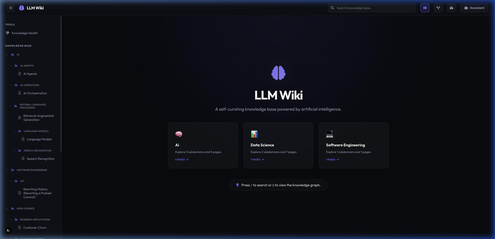
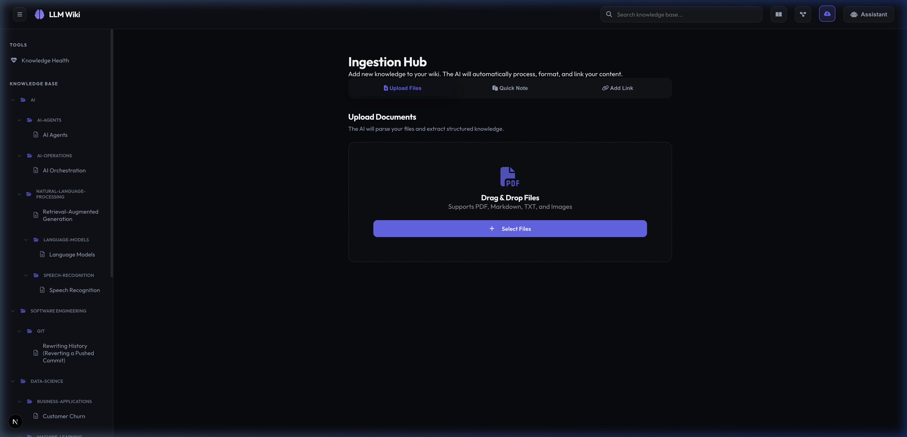
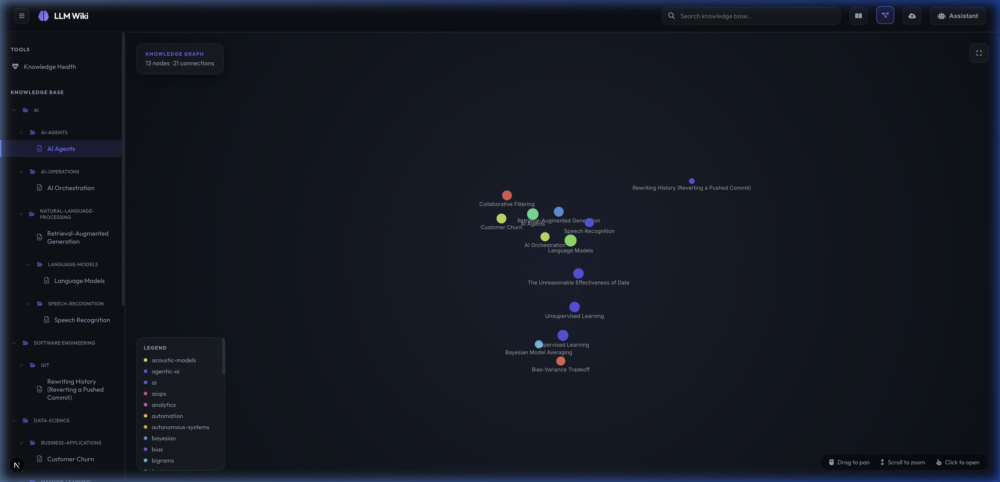
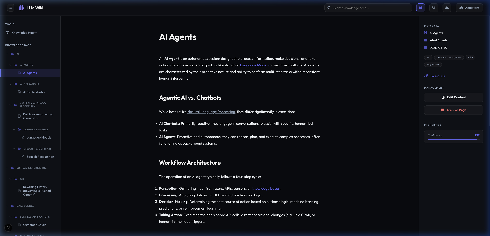

# LLM Wiki: Self-Curating Knowledge Base

LLM Wiki is a premium, AI-driven knowledge management system and macOS desktop application designed to turn raw information into a structured, semantic knowledge graph. Powered by **Google Gemini** (with automatic fallback to local **Ollama** models), it synthesizes notes, URLs, and documents into a cohesive Markdown wiki with intelligent `[[Wikilink]]` connections, hierarchical domain categorization, and self-healing metadata maintenance.



---

## ✨ Key Features

### 🧠 AI-Powered Ingestion Hub
Streamline your knowledge gathering with multi-method ingestion. Whether it's a quick thought, a technical article, or a batch of research documents, the AI engine extracts, formats, and integrates it seamlessly:
- **Quick Note**: Paste raw text or notes directly for immediate synthesis into structured Markdown.
- **Link Ingestion**: Provide a public URL (`http`/`https`), and the AI extracts the core concepts while preserving source provenance.
- **Batch File Upload**: Drag and drop multiple files (`.md`, `.txt`, `.pdf`) for bulk processing with real-time console logs.



### 📊 Semantic Knowledge Graph & Domain Hierarchy
Visualize and navigate your knowledge base effortlessly:
- **Interactive Force-Directed Graph**: Explore relationships between wiki pages and meaningful `#tag` nodes visually (`react-force-graph-2d`), color-coded by top-level domain. Click any page node to jump directly to that article.
- **Dynamic Collapsible Sidebar**: Reflects the real-time folder hierarchy of your knowledge base with collapsible categories and quick actions.
- **Home Analytics Dashboard**: Overview tiles showing total pages, domain breakdowns, and quick navigation.



### 🔗 Intelligent Linking, Provenance & Page Management
Every page is richly structured and easy to curate:
- **Semantic Wikilinks**: Automatic and manual connections to existing knowledge using `[[Title]]` syntax.
- **Source Provenance & Hover Preview**: Automatic source URL tracking in page metadata, complete with an opaque hover tooltip that reveals the full source URL on mouseover of **Source Link**.
- **Rich Frontmatter & Properties**: Validated titles, hierarchical categories, sanitized multi-character `#tags`, last-updated dates, and normalized AI confidence scores (`0–100%`).
- **Inline Editing & Archiving**: Edit Markdown content, titles, and dates directly in-app or archive obsolete pages safely to the `archive/` directory.



### 🔍 Global Search, AI Chat & Self-Healing Health Engine
- **Instant Header Search**: Search across page titles, categories, tags, and content snippets from anywhere in the app with keyboard-friendly dropdown navigation.
- **AI Knowledge Assistant (Chat Drawer)**: Ask natural-language questions against your entire wiki and receive synthesized answers with source attribution.
- **Knowledge Base Health & Auto-Repair**: Scan your wiki for broken `[[Wikilinks]]`, orphaned pages, single-character/malformed tags, or missing frontmatter fields, and repair them with one click.

---

## 🛠️ Tech Stack

- **Framework**: Next.js 16 (App Router, Turbopack), React 19, TypeScript 5
- **Desktop Runtime**: Electron 42 & `electron-builder` (macOS `.app` & `.dmg`)
- **AI Engine**: Google Generative AI SDK (`@google/generative-ai` / Gemini) + Local Ollama HTTP API fallback
- **Knowledge Storage & Parsing**: Local Markdown filesystem, `gray-matter` (YAML frontmatter), `react-markdown`, `remark-gfm`
- **Visualization & Icons**: `react-force-graph-2d`, `lucide-react`, Font Awesome
- **Testing & Linting**: Vitest 4, React Testing Library, `jsdom`, ESLint 9

---

## 🚀 Prerequisites & Local Setup

### Prerequisites
- **Node.js** `v20+` and **npm**
- **AI Provider**:
  - A **Google Gemini API Key** (`GOOGLE_API_KEY`), **or**
  - A local **Ollama** server running at `http://localhost:11434` (used automatically when `GOOGLE_API_KEY` is omitted)

### 🖥️ Option 1: Desktop Application (macOS)

LLM Wiki can be built and run as a standalone macOS application that manages its own background server automatically.

1. **Clone the repository**:
   ```bash
   git clone https://github.com/paulang1807/llm-wiki.git
   cd llm-wiki
   ```

2. **Install local dependencies**:
   ```bash
   npm install
   ```

3. **Build the macOS App**:
   ```bash
   npm run package:mac
   ```
   *(To build only the unpacked `.app` bundle without creating a disk image, run `npm run build && node scripts/build-mac.js && npx electron-builder --mac --dir`.)*

   The packaged application will be output to `release/mac-arm64/LLM Wiki.app` (Apple Silicon) or `release/mac/LLM Wiki.app` (Intel). You can launch it directly or drag `LLM Wiki.app` into `/Applications`.

#### 🗄️ Desktop Data Storage & Configuration
When running as a packaged macOS app, all wiki data and configuration are stored in your user Documents directory:
- **Wiki Notes**: `~/Documents/LLM-Wiki/wiki/`
- **Archived Notes**: `~/Documents/LLM-Wiki/archive/`
- **Environment Configuration**: `~/Documents/LLM-Wiki/.env`

On first launch, if `~/Documents/LLM-Wiki/.env` does not exist, the app automatically generates a template from [`.env.sample`](./.env.sample). Add your `GOOGLE_API_KEY` (or Ollama settings) to this file.

---

### 👨‍💻 Option 2: Local Web Development

To run the web application directly from your terminal during development:

1. **Configure Environment Variables**:
   Copy the sample environment file [`.env.sample`](./.env.sample) to `.env`:
   ```bash
   cp .env.sample .env
   ```
   Edit `.env` and set your `GOOGLE_API_KEY` (or configure `OLLAMA_URL` and `OLLAMA_MODEL` for local inference).

2. **Start the Development Server**:
   ```bash
   npm run dev
   ```
   The launcher script ([`./scripts/start-server.js`](./scripts/start-server.js)) checks port `3000` first and automatically binds to the next available port (`3001`, `3002`, etc.) if `3000` is in use, logging the active URL clearly in the terminal.

3. **Blank-Slate Onboarding**:
   By default, local development stores pages in the workspace's `wiki/`, `raw/`, `archive/`, and `notes/` directories, which are tracked in git via empty `.gitkeep` files so every new clone starts with a clean slate.
   - *Optional*: To point local development at your macOS Desktop App data directory, set `DATA_DIR=~/Documents/LLM-Wiki` in your `.env` file.

---

## 📖 Usage Guide

1. **Ingest Knowledge**: Click **Ingest** in the top header or sidebar. Choose **Quick Note**, **From URL**, or **Upload Files**, then click **Synthesize into Wiki** and monitor progress in the live Engine Console.
2. **Browse & Read Pages**: Expand domain folders in the left sidebar and click any article. In the right-hand **Metadata** panel:
   - Hover over **Source Link** to inspect the full original URL in an opaque tooltip, or click it to open the source in your browser.
   - Review sanitized `#tags` and the normalized AI **Confidence** bar.
   - Use **Edit Content** to modify the page inline or **Archive Page** to move it to `archive/`.
3. **Explore the Knowledge Graph**: Click the **Graph View** icon in the top header to visualize connections across domains and tags. Click any page node to open that note.
4. **Search & Ask AI**:
   - Type in the top **Search knowledge base...** bar to filter and jump to matching notes.
   - Click the **AI Assistant** button in the top-right header to open the Chat Drawer and ask questions synthesized from your notes.
5. **Run Health Checks**: Open the **Health** view from the header to audit broken links, orphaned pages, and metadata consistency, and click **Auto-Repair All Issues** to self-heal your wiki.

---

## 🧪 Testing & Quality Checks

Run the unit test suite (Vitest + React Testing Library) and linter locally:

```bash
# Run all unit tests
npm test

# Run ESLint and TypeScript type checks
npm run lint
npx tsc --noEmit
```

---

## 📺 Demonstration

Watch the AI Knowledge Engine synthesize a quick note into a structured wiki page:


---

Built with ❤️ using Next.js, Electron, and Google Gemini.
